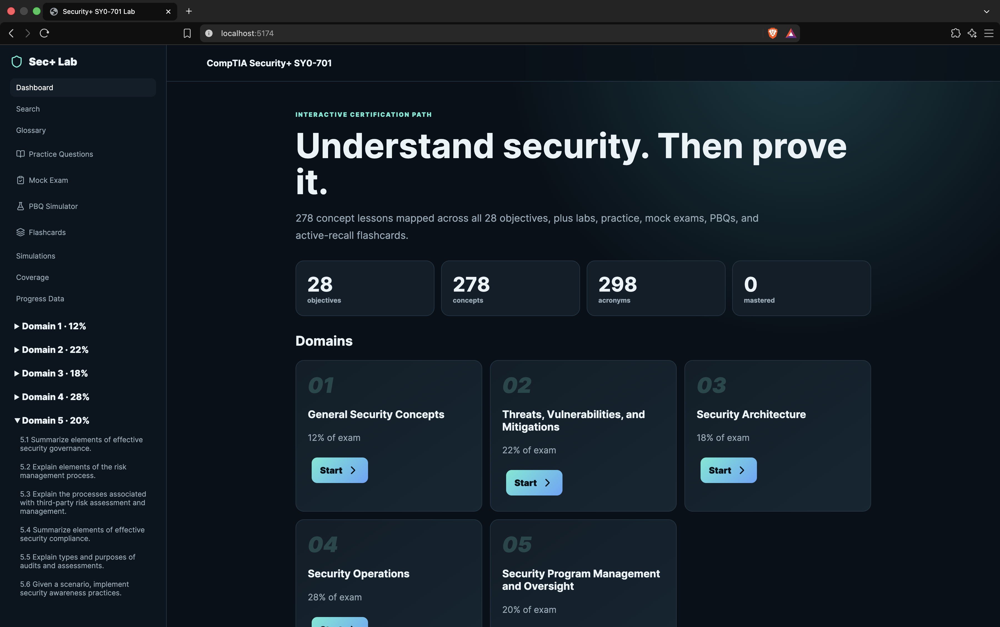
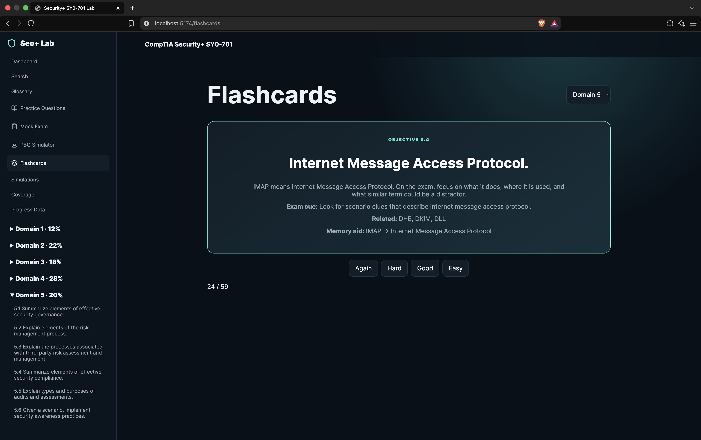
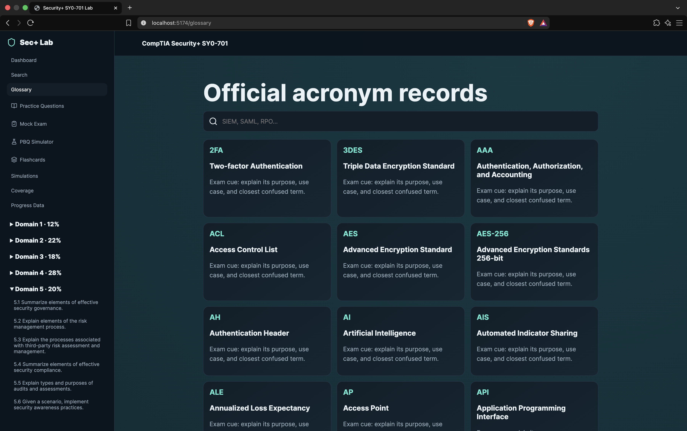
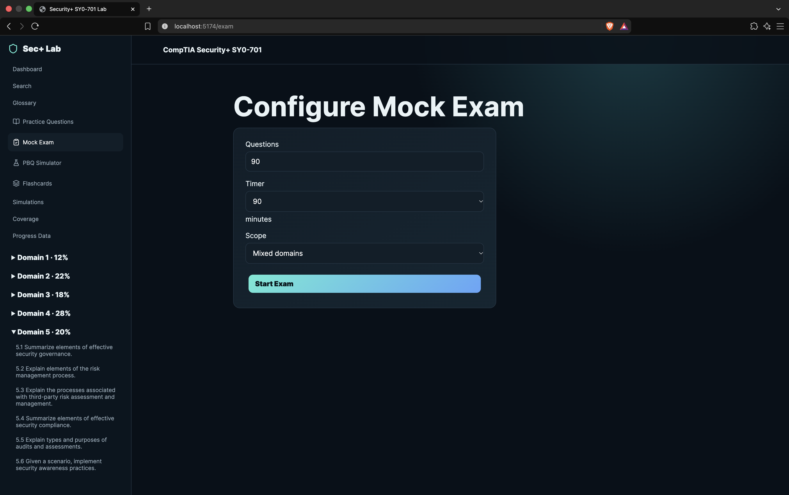
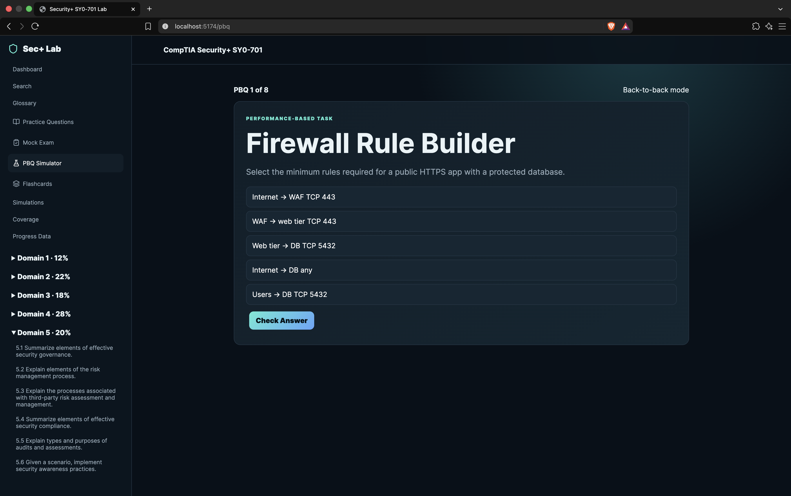
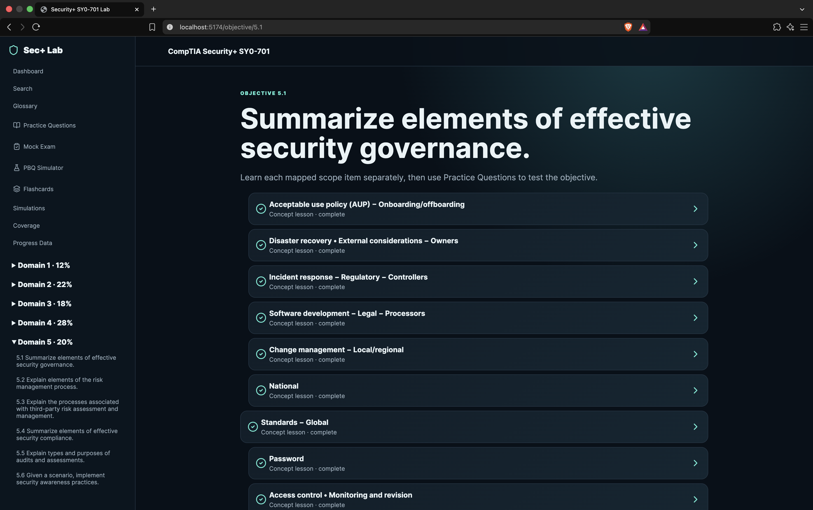

# Security+ SY0-701 Learning Lab v2 merged

## Dashboard



Preserves the original learning platform and adds Practice Questions, a configurable Mock Exam, PBQ Simulator, and Flashcards.

## Run
```bash
npm install
npm run dev
```

## Practice systems
- Practice Questions: domain/objective/difficulty/type filtering, immediate explanations, decisive clues, and per-option feedback.
- Mock Exam: 10-90 configuration, timer, mixed/domain scope, question navigator, flags, raw score, domain breakdown, review.
- PBQ Simulator: 8 back-to-back synthetic educational tasks.
- Flashcards: definitions plus exam cues, related terms, memory aids, and Again/Hard/Good/Easy LocalStorage scheduling.

The project intentionally reports raw practice percentages only and does not reproduce CompTIA proprietary scaled scoring.

## Screenshots

### Flashcards


### Glossary


### Mock Exam


### PBQ Simulator


### Objective Lessons
